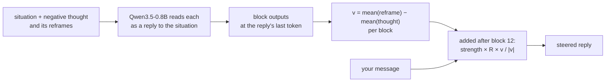

# thought steering

[thought steering](https://gustavecortal.com/thought-steering/) is contrastive activation steering that sets how much a language model reframes negative thoughts. The [live demo](https://gustavecortal.com/thought-steering/) runs Qwen3.5-0.8B in the browser, and this repository fits its steering directions and chats with its steered model from the command line.

<p align="center">
  <a href="https://gustavecortal.com/thought-steering/"></a>
</p>

## Quick start

With [uv](https://docs.astral.sh/uv/getting-started/installation/):

```bash
git clone https://github.com/gustavecortal/thought-steering.git
cd thought-steering
uv run thought-steering chat "I failed my driving test again. I'll never be able to drive." --strength 0.3
```

The first run downloads the 4-bit model from Hugging Face (0.58 GB). Replies then run on the CPU, at about 6 tokens a second on a desktop processor with 16 threads. `--strength -0.3` steers away from reframing, `--blocks 12 16` steers two blocks, and `--attribute empathy=0.2` adds an attribute's direction. Without a message, `chat` holds a conversation. `uv run pytest` checks the steered model, the contrast data and the sampler against the live page.

## How it works



The steering direction is the mean difference between the hidden states of reframes and of the negative thoughts they reframe, from [Cognitive Reframing Pairs](https://huggingface.co/datasets/gustavecortal/cognitive-reframing-pairs), a synthetic dataset I generated. Each text is read as the model's reply to a request for a thought about its situation, at the reply's last token. A thought's reframes are averaged, and the differences are averaged within each situation, then over 128 situations. Reframes whose token length differs from the thought's by more than 15% are left out, so length does not drive the direction.

While the model answers, the direction is added to the residual stream after block 12, at the prompt's last token, just before the reply, and at every token the model writes. The strength sets its length as a fraction of R, that block's median activation norm at the end of a prompt, and negative values point away from the reframes. Seven more directions, one for each reframing attribute of [Sharma et al. (2023)](https://aclanthology.org/2023.acl-long.555/) such as actionability or empathy, are fitted on pairs written to differ in that attribute.

The model is [onnx-community's 4-bit ONNX export](https://huggingface.co/onnx-community/Qwen3.5-0.8B-ONNX-OPT) of Qwen3.5-0.8B, modified to take the steering vector as an input and return each block's output. The directions are fitted on that graph's own activations, in ONNX Runtime on the CPU, and the page runs the same graph with ONNX Runtime Web on WebGPU. Replies are sampled as on the page: temperature 1, top-k 20 and a presence penalty of 2, up to 256 tokens.

| File | Contents |
|---|---|
| [`src/thought_steering/pairs.py`](src/thought_steering/pairs.py) | Contrast data from Cognitive Reframing Pairs |
| [`src/thought_steering/graph.py`](src/thought_steering/graph.py) | The steered graph and its runner |
| [`src/thought_steering/fit.py`](src/thought_steering/fit.py) | The fit of a direction |
| [`src/thought_steering/steer.py`](src/thought_steering/steer.py) | Steering vectors from the fits |
| [`src/thought_steering/chat.py`](src/thought_steering/chat.py) | The page's sampler and replies |
| [`src/thought_steering/prompt.py`](src/thought_steering/prompt.py) | The tokenizer and chat template |
| [`fits/`](fits) | The eight directions the page uses |
| [`tests/test_live.py`](tests/test_live.py) | Checks against the live page's files |

## Rebuild the directions

```bash
uv run thought-steering pairs
uv run thought-steering fit reframe
```

`pairs` downloads the dataset and writes the contrast data to `data/`. `fit` reads it through the steered graph and writes `fits/reframe/fit.safetensors`, in under 3 minutes on the same processor. The result is byte for byte the file the page uses, with ONNX Runtime 1.31. `fit` also takes the attribute names, such as `fit empathy`.

## License

The code is under the [MIT license](LICENSE). Cognitive Reframing Pairs, and the directions in `fits/` fitted on it, are under [CC BY 4.0](https://creativecommons.org/licenses/by/4.0/). Qwen3.5-0.8B is under Apache 2.0.
