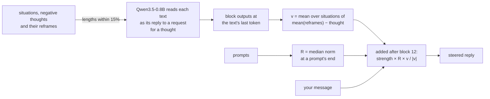

# thought steering

[thought steering](https://gustavecortal.com/thought-steering/) is contrastive activation steering that sets how much a language model reframes negative thoughts. Its [live demo](https://gustavecortal.com/thought-steering/) runs Qwen3.5-0.8B in the browser. This repository fits the steering vectors on the same model and runs the steered model from the command line.

<p align="center">
  <a href="https://gustavecortal.com/thought-steering/"></a>
</p>

## Quick start

With [uv](https://docs.astral.sh/uv/getting-started/installation/), which installs Python 3.12 or later if needed:

```bash
git clone https://github.com/gustavecortal/thought-steering.git
cd thought-steering
uv run thought-steering chat "I failed my driving test again. Maybe I just can't learn things." --strength 0.6
uv run thought-steering chat "I failed my driving test again. Maybe I just can't learn things." --strength 0
```

The first run downloads the 4-bit model from Hugging Face (0.58 GB). Replies then run on the CPU, about 6 tokens a second on a 16-thread desktop processor. Both replies use the same seed, so the second is the unsteered reply the first is compared with.

- Negative strengths steer away from reframing. The clip above uses +0.6 and -0.3, since at -0.6 its reply lost coherence.
- `--blocks 12 16` steers two blocks.
- `--attribute empathy=0.2` adds the direction of one reframing attribute: actionability, empathy, positivity, rationality, readability, specificity or thinking_trap_addressing.
- `--seed` changes the sampled reply, and without a message, `chat` holds a conversation.

`uv run pytest` checks the steered model, the contrast data and the sampler against the live demo.

## How it works



The steering direction is the mean difference between the hidden states of reframes and of the negative thoughts they reframe, from [Cognitive Reframing Pairs](https://huggingface.co/datasets/gustavecortal/cognitive-reframing-pairs), a synthetic dataset I generated. Each text is read as the model's reply to a request for a thought about its situation, and its hidden state is taken at its last token. Within each situation, the differences between a thought and the mean of its reframes are averaged. The 128 situations are then averaged. Reframes whose token length differs from the thought's by more than 15% are left out, so length does not drive the direction.

While the model answers, the direction is added to the residual stream after block 12, at the prompt's last token and at every token the model writes. The strength sets its length as a fraction of R, that block's median activation norm at the end of a prompt, and negative values point away from the reframes. Seven more directions, one for each reframing attribute of [Sharma et al. (2023)](https://aclanthology.org/2023.acl-long.555/), such as actionability or empathy, are fitted on pairs written to differ in that attribute. [Steering LLM thoughts with cognitive reframing](https://gustavecortal.com/writing/steering-llm-thoughts/) studies what the steering changes at each layer of Qwen3-4B.

The model is [onnx-community's 4-bit ONNX export](https://huggingface.co/onnx-community/Qwen3.5-0.8B-ONNX-OPT) of Qwen3.5-0.8B, modified to take the steering vector as an input and return each block's output. The directions are fitted on that graph's own activations, with ONNX Runtime on the CPU. The live demo runs the same graph with ONNX Runtime Web on WebGPU. Replies are sampled as there: temperature 1, top-k 20 and a presence penalty of 2, up to 256 tokens.

| File | Contents |
|---|---|
| [`src/thought_steering/pairs.py`](src/thought_steering/pairs.py) | Contrast data from Cognitive Reframing Pairs |
| [`src/thought_steering/graph.py`](src/thought_steering/graph.py) | The steered graph and its runner |
| [`src/thought_steering/fit.py`](src/thought_steering/fit.py) | Mean-difference fit and the norm R |
| [`src/thought_steering/steer.py`](src/thought_steering/steer.py) | Steering vectors from the fits |
| [`src/thought_steering/chat.py`](src/thought_steering/chat.py) | The live demo's sampler and replies |
| [`src/thought_steering/prompt.py`](src/thought_steering/prompt.py) | The tokenizer and chat template |
| [`fits/`](fits) | The eight directions the live demo uses |
| [`tests/test_live.py`](tests/test_live.py) | Checks against the live demo's files |

## Rebuild the directions

```bash
uv run thought-steering pairs
uv run thought-steering fit reframe
```

`pairs` downloads the dataset and writes the contrast data to `data/`. `fit` reads it through the steered graph and overwrites `fits/reframe/`. It takes under 4 minutes on the same processor. Its `fit.safetensors` is byte for byte the file the live demo uses (checked with ONNX Runtime 1.30 and 1.31). Its `fit.json` records the ONNX Runtime version you ran. `fit` also takes the attribute names, such as `fit empathy`.

## License

The code is under the [MIT license](LICENSE). Cognitive Reframing Pairs, and the directions in `fits/` fitted on it, are under [CC BY 4.0](https://creativecommons.org/licenses/by/4.0/). Qwen3.5-0.8B is under Apache 2.0.
