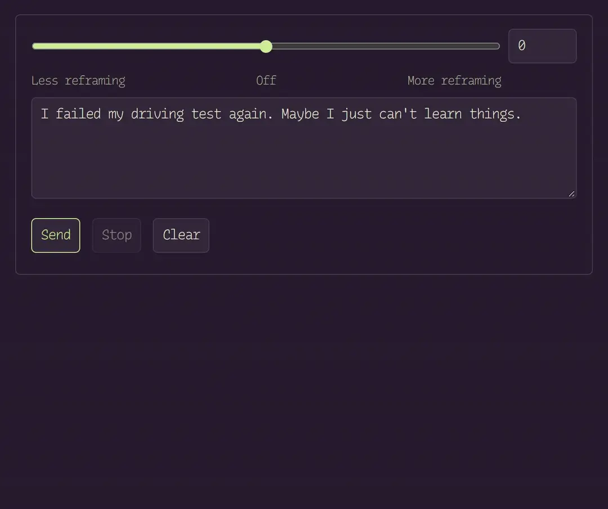

# thought steering

[thought steering](https://gustavecortal.com/thought-steering/) is contrastive activation steering that sets how much a language model reframes negative thoughts. This repository fits the steering on Qwen3.5-0.8B, the model of the [live demo](https://gustavecortal.com/thought-steering/), and runs it from the command line.

<p align="center">
  <a href="https://gustavecortal.com/thought-steering/"></a>
</p>

## Quick start

```bash
git clone https://github.com/gustavecortal/thought-steering.git
cd thought-steering
uv run thought-steering chat "I failed my driving test again. Maybe I just can't learn things." --strength 0.6
```

The first run downloads the model (0.58 GB). Replies then run on the CPU. `--strength 0` gives the unsteered reply, and negative strengths steer away from reframing.

## How it works

The model reads negative thoughts and reframes of them from [Cognitive Reframing Pairs](https://huggingface.co/datasets/gustavecortal/cognitive-reframing-pairs). The steering direction is the mean difference between its hidden states for the reframes and for the thoughts. While the model answers, this direction, scaled by the strength, is added to its hidden states after block 12 of 24.

## Rebuild the direction

```bash
uv run thought-steering pairs
uv run thought-steering fit reframe
```

`pairs` downloads the dataset, and `fit` rewrites `fits/reframe/` in under 4 minutes on the CPU.

## License

The code is under the [MIT license](LICENSE). The dataset, and the directions in `fits/` fitted on it, are under [CC BY 4.0](https://creativecommons.org/licenses/by/4.0/).
